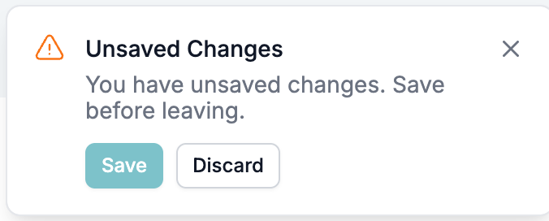

An email template is a message you write once and send many times, in an automation or a newsletter. Open **Settings**, then **Emails** under **Templates**, and click **New Email**. Select **Blank Email** or one of the ready-made templates, and the new template opens in the builder.

This page maps the builder. For a walkthrough that takes one email from blank to ready, read [Setting up an email template in HireData](/apps/messaging/emails/setting-up-an-email-template-in-hiredata).

## The builder at a glance

The builder has three parts.

- The **Subject** box across the top. It is the line the recipient sees in their inbox, and it takes variables.
- The email itself, at the width your recipients see it. You select and edit everything right on it.
- The sidebar on the right, with three tabs: **Styles** for the settings of what you selected, **Add** for new blocks, layouts and section templates, and **Global** for the settings of the whole email.

A template holds sections, and a section holds the blocks the recipient reads. [Template](/reference/email-builder/template) explains how the levels nest.

## Selecting and editing

- **Hover** over a block or section to outline it with its name.
- **Click** to select it. Its settings open in **Styles**.
- **Click a selected text block again**, or double-click it, to edit the text.
- **Escape** stops editing first, then clears the selection.
- **Keyboard:** **Tab** selects the first block, the arrow keys move between blocks, **Enter** edits and **Delete** removes.

A selected block shows an actions bar with **Move**, **Add below**, **Duplicate** and **Delete**, and a menu with the settings for that kind of block. On a block taller than the screen, the menu stays in view.

### Text

- **Enter** starts a new line inside the paragraph or heading. It doesn't create a new block.
- **Lists:** make lines bulleted or numbered. Enter continues the list.
- **The text menu** sets the font, size, colour, highlight, alignment, list and link, with more under **More**. It formats the whole block, or only the text you selected.
- **Links:** the link button opens a menu to add, edit or remove a link. A link typed without "https" gets it added.

## Adding, copying and moving

- **The Add tab** lists layouts, section templates and content blocks. Drag one onto the email: a line shows where it lands.
- **Add below** adds a block under the selected one. A new text block starts in edit mode.
- **Duplicate** copies a block or section, including its translations.
- **Move** drags a block or section to the line where you drop it. Escape cancels.
- **Sections** only go at the top level of the email, never inside another section.
- **An emptied section or column** keeps its place and shows a zone where you can drop or add a block.

## Choosing a block

| Block | What it puts in the email |
| --- | --- |
| [Section](/reference/email-builder/sections) | a band across the email, with its own background, padding and border |
| Split section | a section split into columns side by side, with its own layout and gap settings. It's selected and moved as one block |
| [Paragraph](/reference/email-builder/blocks/paragraph) | body text, including bulleted and numbered lists |
| [Heading](/reference/email-builder/blocks/heading) | a heading, at the level you pick |
| [Form](/reference/email-builder/blocks/form) | buttons that answer a question from one of your forms |
| [Image](/reference/email-builder/blocks/image) | a picture from your media library, or one held in a variable |
| [Socials](/reference/email-builder/blocks/socials) | a row of social icons, one per link |
| [Button](/reference/email-builder/blocks/button) | a call to action that opens a URL |
| Divider | a line between blocks |
| Whitespace | empty space between blocks |
| [HTML](/reference/email-builder/blocks/html) | markup you write yourself |
| [Signature](/reference/email-builder/blocks/signature) | a picture beside a block of sign-off text |

Columns are added as a split section. Columns in emails made before this change are kept and can still be duplicated.

## Spacing

Select a block and click **Spacing** to see its margins and padding on the canvas. Drag a handle or type a value, and use the lock to change sides together. **Done** keeps the values. The spacing box in **Styles** edits the same values. Paragraph, heading and socials blocks also have left and right margins.

## Settings for the whole email

The **Global** tab holds the template settings and **All sections**. A change under **All sections** applies to every section, including sections you add later.

**Section width** is set once for the whole email: **Default**, **Wide** (640px), **Large** (700px) or **Custom** (between 640 and 1240 pixels). The background, link colour and fonts are set here too.

## The toolbar

The toolbar runs along the top of the builder, from **Save** to the four drawer buttons on the right.

**Save** stores your changes. **Undo** and **Redo** sit next to it and work with the usual keyboard shortcuts too. Each action is one step, such as a whole drag or one change in a sidebar field.

Two buttons follow it:

- The eye opens a [preview](/reference/email-builder/testing#the-preview) of the finished email, at mobile, tablet, or desktop width, with a language picker and a **Copy Preview URL** button. Its tooltip warns that it saves the email first.
- The paper plane opens [Test Email](/reference/email-builder/testing#sending-a-test-email). It sends the email to you with realistic values filled in.

**Brand** picks the brand the email's colours, fonts, and logo come from.

Two toggles follow the brand selector:

- **Show variable values** is a display toggle for the canvas. To read an email with real values in it, use the [preview](/reference/email-builder/testing#the-preview).
- **Show code editor** opens the generated markup. It appears only for accounts that may edit templates directly.

Four buttons at the end open drawers over the email:

- **Show variable list** lists the variables this email can use, and adds ones of your own. See [Variables](/reference/email-builder/variables).
- **Manage Template** publishes the open email to the shared template library. It appears only for accounts that maintain that library.
- **Show objects** links records such as a vacancy or a match to the email. Their fields then become [variables](/reference/email-builder/variables#bringing-in-a-records-fields) you can write into it.
- **Manage Languages** sets the email's default language and its [translations](/reference/email-builder/translations).

## Brand and theme

Every colour and font in a new email starts as a value from the brand you pick in **Brand**. The panel names the value rather than showing a hex code, such as "Theme: Palette Surface Color".

Switch **Brand** and the whole email restyles, blocks you already wrote included. Replace one of those values with a colour of your own and that one control stops following the brand. See [Template](/reference/email-builder/template#brand-theme-and-metadata) for the settings that decide it, and for the difference between switching brand and setting a theme.

## Saving

The email builder does not save as you type. **Save** saves. The preview button and **Send test email** each save before they run, so either of those commits whatever you have changed. See [Testing](/reference/email-builder/testing).

Undo every change and the email no longer counts as unsaved.

Try to leave the builder with unsaved changes and a warning appears. It offers to **Save** them, or to **Discard** them and carry on.

Reload the page or close the tab instead and your browser asks you to confirm before you lose them.

## Related

- [Setting up an email template in HireData](/apps/messaging/emails/setting-up-an-email-template-in-hiredata) walks one email from blank to ready.
- [Adding images to your emails](/apps/messaging/emails/adding-images-to-your-emails) covers the media library.
- [Variables](/reference/email-builder/variables) covers the picker, the fallbacks, and what a missing value looks like.
- [Translations](/reference/email-builder/translations) covers sending one email in several languages.
- [Testing](/reference/email-builder/testing) covers the preview, the test send, and what neither of them proves.
- [Form Builder: Overview](/reference/forms/overview) covers the forms a Form block can point at.
